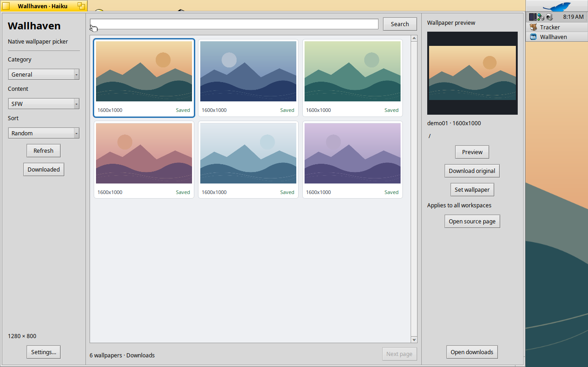
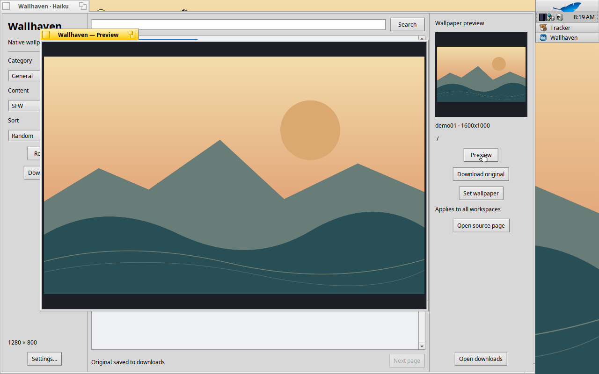
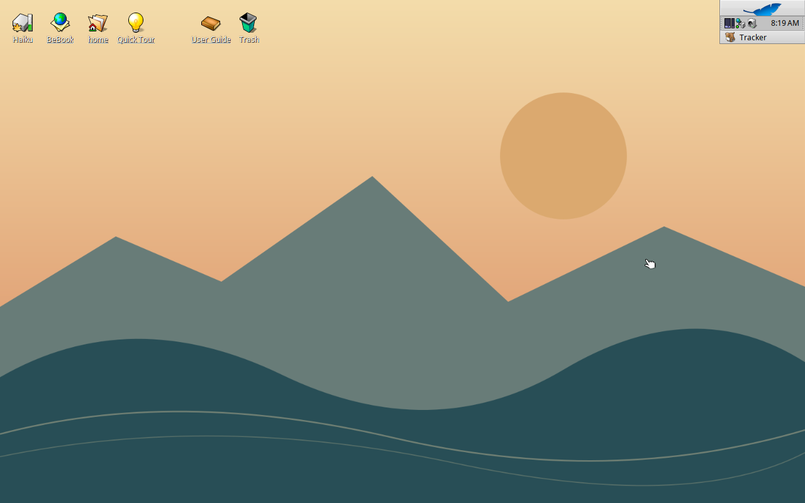

# Wallhaven for Haiku

An unofficial native wallpaper browser for wallhaven.cc, built for Haiku x86_64.
Browse wallpapers, preview and download originals, explore saved images offline,
and apply a background to all workspaces. English is the default; Chinese is
available in Settings.

Project: https://github.com/lhfchym/wallhaven-haiku

Bug reports: https://github.com/lhfchym/wallhaven-haiku/issues

## Status and installation

This source snapshot is being prepared for public distribution. It has not been
accepted into HaikuPorts, and a public binary release is not yet available.

The existing implementation was tested on Haiku R1 beta6 hrev59866+79, x86_64.
When a release package is available, install its local HPKG using `pkgman install`
or Haiku's package installer, then launch Wallhaven from Deskbar → Applications.
Quit the app before upgrading. `pkgman uninstall wallhaven` removes the application
but preserves preferences, history, cache and downloaded images.

## Build and test

On Haiku, install the system development tools and `curl_devel`, then:

```sh
# Run from this Haiku directory
make -j2
make test
./Wallhaven
```

`make test-live` additionally exercises real search, thumbnail/original download,
cache reuse and pagination. It needs network access and may fail during service
outages. `make install` is a developer installation; avoid keeping it alongside
an installed HPKG with the same application signature.

To create a distribution package on Haiku, run `./package.sh`. Its metadata
points to the project repository above. The HaikuPorter recipe is maintained separately until a public source
archive and checksum are available.

## Use

Search by keyword or adjust category, content and sorting filters. Select a
wallpaper to preview it. Download original saves it locally; Set wallpaper uses
the image as the background on all workspaces. Downloaded lists saved images.
Change the language in Settings and restart to apply it. Existing language
preferences are preserved during upgrades.

## Data and privacy

- Preferences and history: `~/config/settings/Wallhaven/`.
- Thumbnail cache: `~/config/cache/Wallhaven/thumbnails/`.
- Default downloads: `~/Pictures/Wallhaven/`, configurable in Settings.
- API keys are saved locally, unencrypted, with owner-only permissions.
- The key is sent as an `X-API-Key` header only to the Wallhaven API, not in URLs
  or requests to the image CDN. Never include it in an issue report.

Online requests contact wallhaven.cc and its image servers directly over HTTPS.
Keep the original file used as your background in place: Tracker loads it even
when Wallhaven is closed. Removing the application does not remove that image.

## Limitations

Only x86_64 is tested. Background changes apply to all workspaces; there is no
per-monitor or per-workspace selection. Image support depends on installed Haiku
translators. Network failures and rate limits can interrupt browsing or downloads.
Real-account restricted-content authentication has not been tested with an owner
API key. The build uses Haiku's private JSON support interface, which may require
maintenance across system updates.

## Contributing and licensing

See [CONTRIBUTING.md](https://github.com/lhfchym/wallhaven-haiku/blob/main/CONTRIBUTING.md) for useful bug reports and development checks,
and [RELEASE_NOTES.md](https://github.com/lhfchym/wallhaven-haiku/blob/main/RELEASE_NOTES.md) for the draft release description.
Project code and original icons are MIT licensed; see [LICENSE](LICENSE).
[Third-party notices](THIRD_PARTY_NOTICES.txt) cover the linked JSON code.
Downloaded wallpapers are not covered by the project license. This application
is not affiliated with or endorsed by Wallhaven or the Haiku Project.

## Screenshots

The screenshots below show the **offline Downloaded gallery** with original
geometric demo artwork, not live Wallhaven search results. They were captured
from the running English application. See [SCREENSHOTS.md](https://github.com/lhfchym/wallhaven-haiku/blob/main/SCREENSHOTS.md)
for provenance, licensing and the exact build used.






