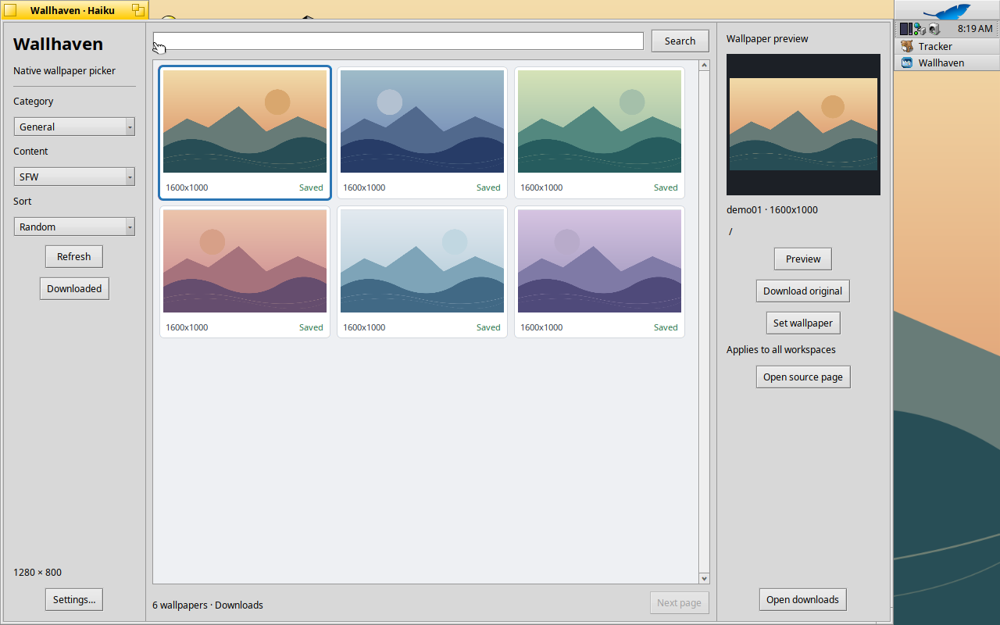
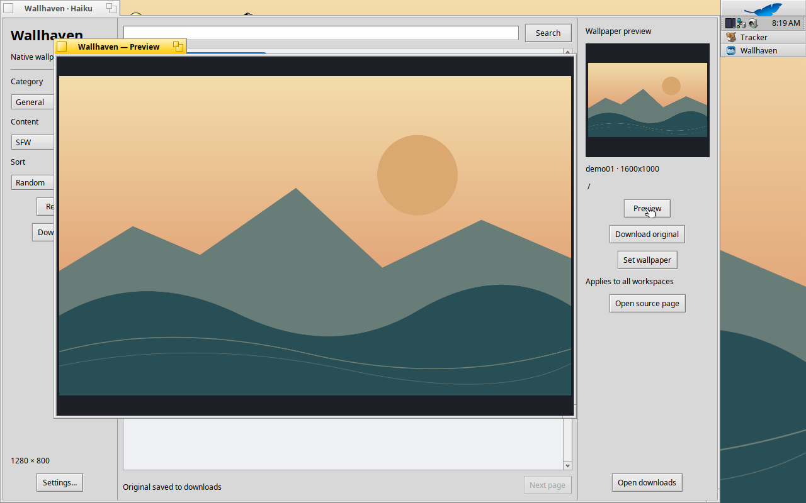
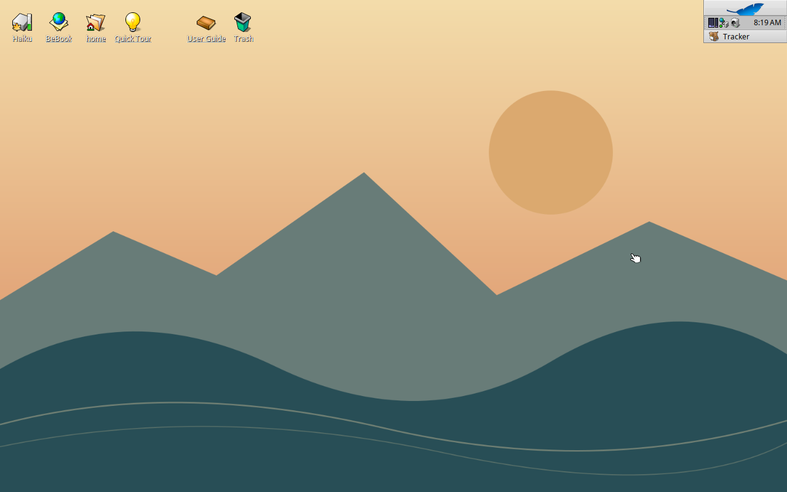

# Wallhaven for Haiku

[English](README.md) | **简体中文**

面向 Haiku x86_64 的非官方 wallhaven.cc 原生壁纸浏览工具。支持浏览壁纸、预览和下载原图、离线查看已下载图片，以及将壁纸应用到当前、指定或所有工作区。首次启动默认英文，可在设置中切换为中文。

项目地址：https://github.com/lhfchym/wallhaven-haiku

问题反馈：https://github.com/lhfchym/wallhaven-haiku/issues


## 版本与安装

从 [1.1.0 发布页](https://github.com/lhfchym/wallhaven-haiku/releases/tag/v1.1.0) 下载 x86_64 安装包及校验和。当前包修订号为 1，项目尚未被 HaikuPorts 收录。

已在 Haiku R1 beta6 hrev59866+79、x86_64 上验证。下载后执行：

```sh
pkgman install ./wallhaven-1.1.0-1-x86_64.hpkg
```

安装完成后，从 Deskbar → Applications 启动 Wallhaven。升级前请退出应用。
执行 `pkgman uninstall wallhaven` 可卸载应用，偏好设置、历史记录、缓存和已下载图片会保留。

## 构建与测试

在 Haiku 中安装系统开发工具和 `curl_devel`，然后执行：

```sh
cd Haiku
make -j2
make test
./Wallhaven
```

`make test-live` 会额外测试真实搜索、缩略图与原图下载、缓存复用和分页，需要联网，服务不可用时可能失败。
`make install` 用于开发安装；请避免与具有相同应用签名的 HPKG 安装版同时存在。

在 `Haiku` 目录运行 `./package.sh` 可生成安装包，包元数据指向本项目公开仓库。
[HaikuPorter recipe](haikuporter/wallhaven-1.1.0.recipe) 固定了实际构建源码归档及其校验和，也作为发布附件提供。

## 使用方法

输入关键词搜索，或调整分类、内容和排序筛选。选择壁纸后可进行以下操作：

- **Preview / 查看大图**：预览原图。
- **Download original / 下载原图**：将图片保存到本地。
- **Set wallpaper / 设为桌面壁纸**：将图片应用到“应用到”中所选的工作区。
- **Downloaded / 已下载**：离线浏览已保存的图片。

在 **Settings / 设置** 中切换界面语言，重启应用后生效。升级会保留已有的语言选择。

## 数据与隐私

- 偏好设置和历史记录：`~/config/settings/Wallhaven/`。
- 缩略图缓存：`~/config/cache/Wallhaven/thumbnails/`。
- 默认下载目录：`~/Pictures/Wallhaven/`，可在设置中修改。
- API Key 以未加密形式保存在本地，文件权限仅允许所有者访问。
- API Key 仅通过 `X-API-Key` 请求头发送到 Wallhaven API，不放入 URL，也不发送给图片 CDN。提交问题报告时请勿包含密钥。

在线请求通过 HTTPS 直接连接 wallhaven.cc 及其图片服务器。请保留设为壁纸的原始图片：即使应用已关闭，Tracker 仍会读取该文件。卸载应用不会删除这张图片。

## 已知限制

目前仅验证了 x86_64。其他工作区的背景会保留；暂不支持按显示器分别设置。
图片格式支持取决于已安装的 Haiku 图像转换器（translators）。网络故障和服务限流可能中断浏览或下载。
尚未使用真实账户的 API Key 验证受限内容访问。构建使用 Haiku 的私有 JSON 接口，系统更新后可能需要适配。

## 贡献与许可证

问题反馈及开发检查要求见 [CONTRIBUTING.md（英文）](CONTRIBUTING.md)，版本详情见[发行说明](RELEASE_NOTES.zh-CN.md)。
项目代码和原创图标采用 MIT 许可证，见 [LICENSE](LICENSE)。静态链接的 JSON 组件版权见[第三方声明](Haiku/THIRD_PARTY_NOTICES.txt)。
下载的壁纸不受本项目许可证覆盖。本应用与 Wallhaven、Haiku Project 均无隶属关系，也未获得其背书。

## 截图

以下截图展示的是使用原创几何演示素材的**离线“已下载”图库**，并非 Wallhaven 实时搜索结果。
截图来自实际运行的英文界面；素材来源、许可及截图所用版本见 [SCREENSHOTS.md（英文）](SCREENSHOTS.md)。







## 翻译

参见 [catkeys 指南](Haiku/locales/README.md)。目录资源内嵌于程序，设置中的语言选项在重启后生效。
